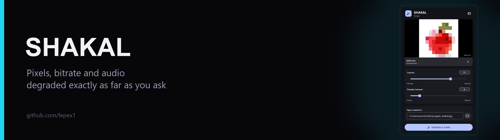
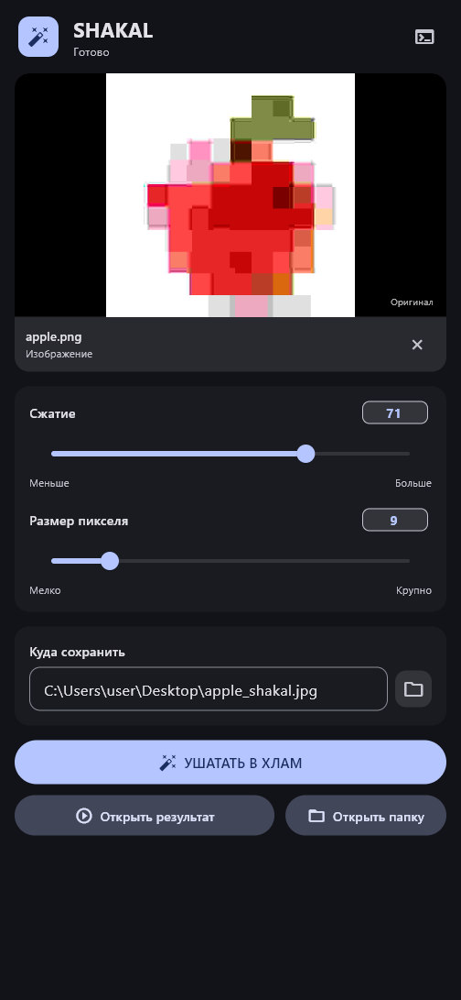
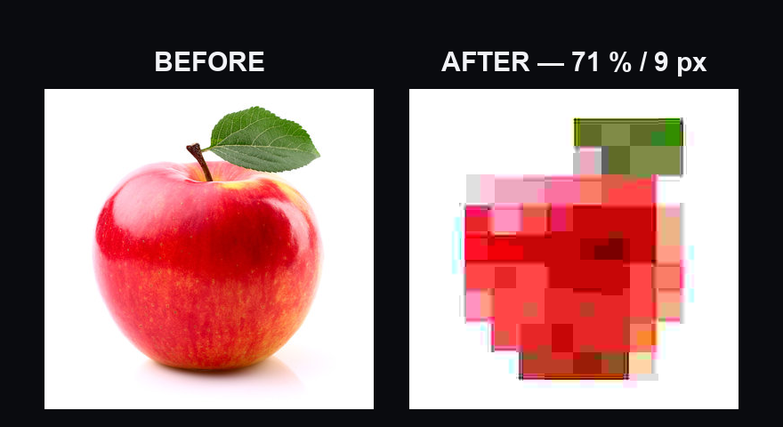
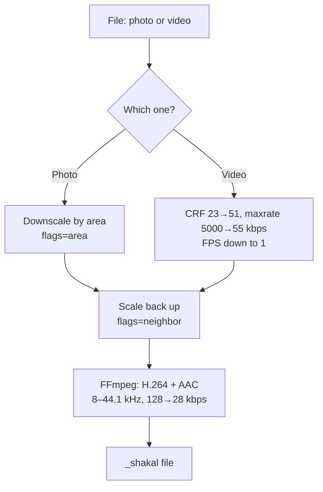

<p align="center">
  <a href="README.md">Русский</a> · <b>English</b>
</p>

# SHAKAL

<p align="center">
  
</p>

<p align="center">
  <a href="https://github.com/lepex1/shakal/releases/latest"></a>
  <a href="https://github.com/lepex1/shakal/releases"></a>
  
  
  <a href="LICENSE"></a>
</p>

<p align="center">
  <b>Turns photos and videos into 2007-grade potato quality.<br>
  Pixels, bitrate, audio and metadata are ruined exactly as far as the slider lets you.</b>
</p>

<p align="center">
  <a href="https://github.com/lepex1/compress">Sibling project: compress</a>
</p>

## Demo

<!--
  DEMO SLOT: record assets/demo.gif (a real run, up to 5 MB, 880 px wide)
  and uncomment the block below.
<p align="center">
  
</p>
-->

---

## Screenshot

<p align="center">
  
</p>

<p align="center">
  
</p>

---

## Why it exists

Sometimes you want quality to go down, not up: a meme for a chat, a joke for a friend, a picture that must look like it came off a 2007 phone. Regular converters compress carefully and stop at the “optimal” bitrate, while pixelation editors process one photo at a time.

`shakal` makes the degradation controllable:

1. **Opens** the file and figures out whether it is a photo or a video.
2. **Pixelates**: shrinks the frame by area (`flags=area`) and stretches it back with nearest-neighbour (`flags=neighbor`) — big honest pixels instead of a blurry smear.
3. **Kills the bitrate**: CRF 23 → 51, `maxrate` 5000 → ~55 kbps on an exponential curve; video FPS drops as low as 1 frame per second.
4. **Wrecks the audio**: 44.1 kHz → 22.05 / 16 / 8 kHz, AAC bitrate 128 → 28 kbps at the maximum.
5. **Saves** the result next to the source with a `_shakal` suffix and strips metadata along the way: images are re-encoded from scratch with no EXIF, GPS coordinates or camera model.

A single photo is instant; video is a real H.264 pass, so time depends on length and resolution.

---

## Compatibility

| Parameter | Value |
|---|---|
| **OS** | Windows 10/11 x64 — tested. macOS and Linux: the Flutter code should build, but has not been tested |
| **Images** | JPG, JPEG, PNG, BMP, WebP — re-encoded from scratch, source metadata is not carried over |
| **Video** | MP4, AVI, MOV, MKV, WebM — H.264 + AAC via FFmpeg |
| **Settings** | Quality 0–100, pixel size 1–50 px, video FPS from 1 up to the source rate |
| **Audio** | 44.1 kHz below quality 30 → 22.05 kHz → 16 kHz → 8 kHz at 90 and above; AAC bitrate 128 → 28 kbps |
| **Engine** | FFmpeg: the `ffmpeg-master-latest-win64-gpl` build from BtbN FFmpeg-Builds (~100 MB), downloaded automatically when no binary is found |

---

## Quick start (Windows)

1. Download **`shakal-win-x64.zip`** from **[Releases](https://github.com/lepex1/shakal/releases/latest)** (~13 MB, ~30 MB unpacked).
2. Unpack it anywhere and run `shakal.exe`.
3. Windows will show SmartScreen — normal for an unsigned build: “More info” → “Run anyway”.
4. Drop a file into the window, set **«Сжатие»** and press **«УШАТАТЬ В ХЛАМ»**.

No installation required — the Flutter runtime is bundled. FFmpeg is only needed for video and is fetched on first launch. The UI is Russian-only.

**Where the result goes:** next to the source file with a `_shakal` suffix, e.g. `C:\Users\user\Desktop\photo_shakal.jpg`. The buttons **«Открыть результат»** and **«Открыть папку»** appear once processing is done.

---

## Run from source

```bash
git clone https://github.com/lepex1/shakal.git
cd shakal
flutter pub get
flutter build windows --release
./build/windows/x64/runner/Release/shakal.exe
```

**Requirements:** Flutter SDK 3.x and Visual Studio with “Desktop development with C++” — build only. Running a prebuilt copy needs Windows 10/11 x64.

For development: `flutter run -d windows`.

---

## How the degradation works



The key formulas from the code:

```
CRF       = 23 + quality * 28 / 100          # 23 … 51
maxrate   = 5000 * exp(-0.045 * quality)     # 5000 … ~55 kbps
audio     = clamp(128 - quality, 8, 128)     # 128 … 28 kbps
JPEG q    = 95 * (1 - quality)³ + 1          # for images
```

What sets it apart from “just compress it”:

- **Pixelation, not blur**: area averaging plus nearest-neighbour upscale gives an even blocky grain with no halos and no soft frame.
- **Pixel size and quality are separate sliders**: grain size and bitrate destruction are tuned independently.
- **Metadata is never carried over**: images are re-encoded, videos are transcoded, so EXIF and service tags from the source never reach the output.
- **No need to install FFmpeg by hand**: if there is no binary nearby, the app downloads a fresh build and shows progress.

---

## ⚠️ Read this

- **The output is deliberately bad.** At high quality settings the stream drops below 55 kbps and some players and messengers simply refuse to open the file.
- **Audio becomes “telephone-grade”.** At quality 90 and above the sample rate drops to 8 kHz — that is the effect, not a bug.
- **Metadata is gone for good** in the output: the source stays untouched, but GPS location and camera model cannot be recovered from the copy.
- **One file at a time.** There is no batch mode.
- **The first video run needs internet** until FFmpeg is downloaded. Photos are processed locally and need nothing.

---

## FAQ

**SmartScreen/antivirus flags the `.exe`.**
That happens with every unsigned build (a code-signing certificate costs money). You can skip the archive and build from source — the code is open.

**The file will not open in a messenger after the treatment.**
That is the point: on extreme settings the bitrate falls below 55 kbps and players refuse it. Lower «Сжатие».

**Why does the audio sound flat and “telephone-like”?**
From quality 60 the sample rate drops to 22.05–16 kHz, from 90 to 8 kHz. That is part of the effect.

**Is metadata really stripped?**
Yes. Images are re-encoded from scratch (a fresh JPEG without EXIF), videos are transcoded by FFmpeg, and service tags of the source are not carried over.

**Do I need FFmpeg installed?**
No: if there is no binary nearby, the app downloads a build from BtbN FFmpeg-Builds and shows progress.

---

## License

[MIT](LICENSE) — take it, fork it, break it.

This project is **not affiliated** with FFmpeg or its build providers. The list of third-party components and their licenses is in [THIRD-PARTY-NOTICES.md](THIRD-PARTY-NOTICES.md): FFmpeg (LGPL-2.1+ / GPL-2.0+ for the `gpl` build), BtbN FFmpeg-Builds, Flutter and pub.dev packages.

---

<p align="center">
  Built by <a href="https://lepex.vercel.app/">lepex1</a>
</p>
