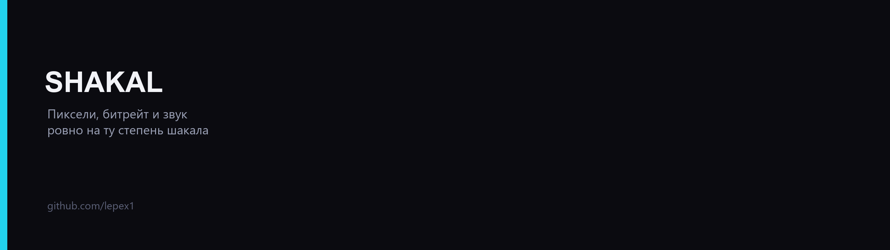
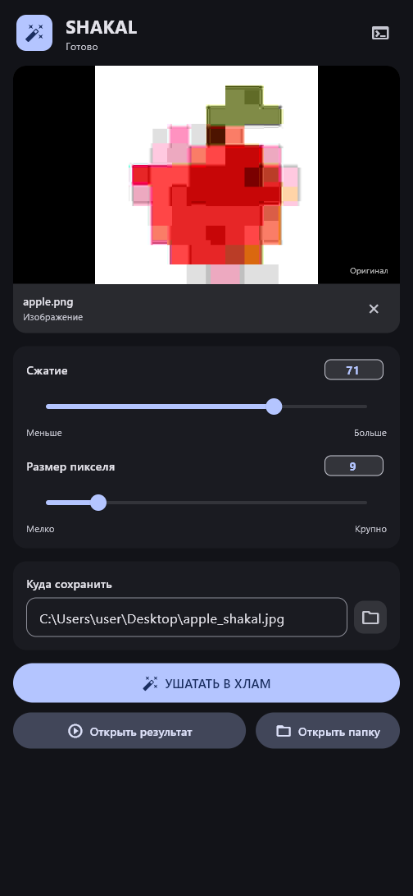
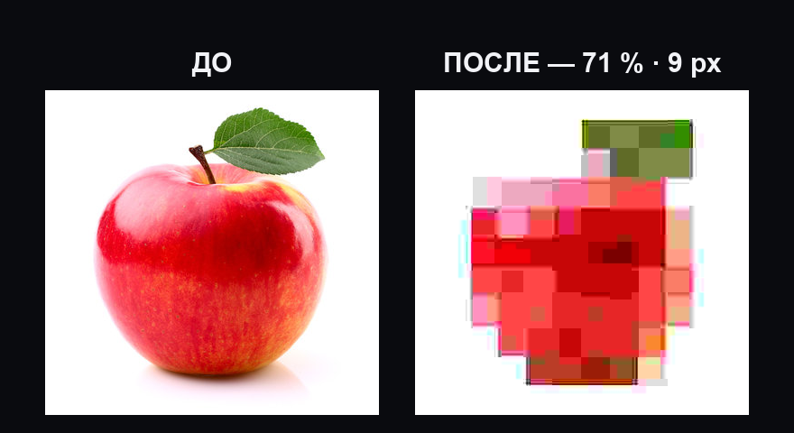
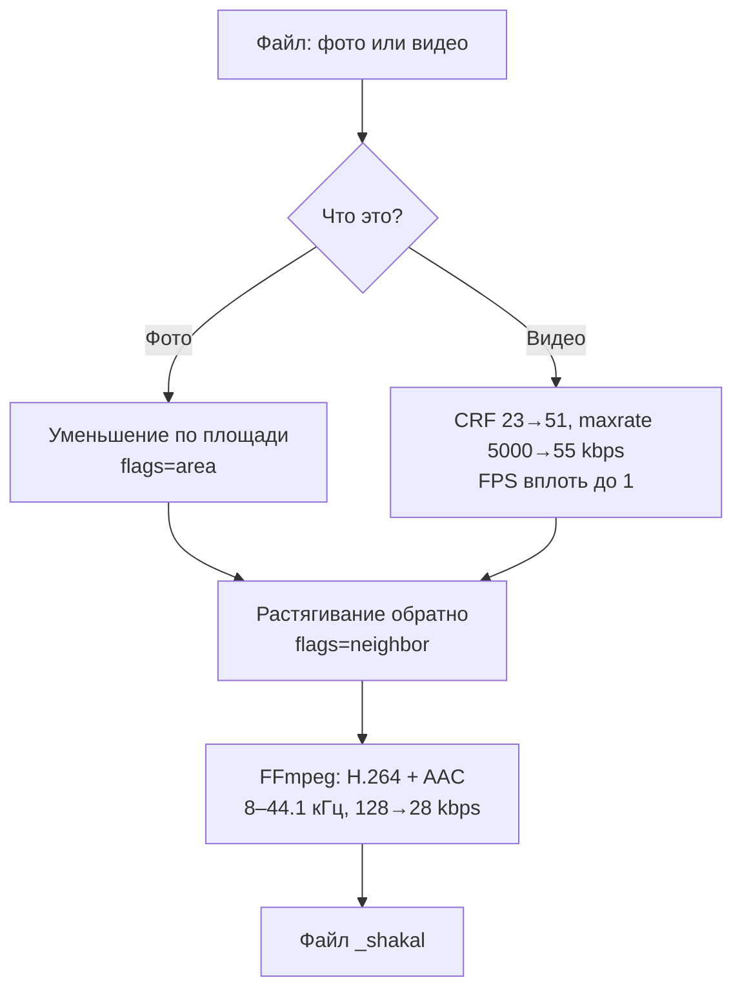

<p align="center">
  <b>Русский</b> · <a href="README.en.md">English</a>
</p>

# SHAKAL

<p align="center">
  
</p>

<p align="center">
  <a href="https://github.com/lepex1/shakal/releases/latest"></a>
  <a href="https://github.com/lepex1/shakal/releases"></a>
  
  
  <a href="LICENSE"></a>
</p>

<p align="center">
  <b>Превращает фото и видео в шакалов — до уровня 2007 года.<br>
  Пиксели, битрейт, звук и метаданные портятся ровно настолько, насколько позволяет ползунок.</b>
</p>

<p align="center">
  <a href="https://github.com/lepex1/compress">Соседний проект: compress</a>
</p>

## Демонстрация

<!--
  ДЕМО-СЛОТ: записать assets/demo.gif (реальный запуск, до 5 МБ, ширина 880 px)
  и раскомментировать блок ниже.
<p align="center">
  
</p>
-->

---

## Скриншот

<p align="center">
  
</p>

<p align="center">
  
</p>

---

## Зачем это нужно

Иногда качество нужно не сохранить, а наоборот — уронить: мем для чата, «шакал» для друга, картинка, которая должна выглядеть как снимок с телефона 2007 года. Обычные конвертеры сжимают аккуратно и упираются в «оптимальный» битрейт, а редакторы пикселизации обрабатывают по одному фото.

`shakal` делает деградацию управляемой:

1. **Открывает** файл и сам определяет, фото это или видео.
2. **Пикселизует**: уменьшает кадр по площади (`flags=area`) и растягивает обратно по ближайшему соседу (`flags=neighbor`) — получаются крупные честные пиксели, а не мыло от размытия.
3. **Убивает битрейт**: CRF 23 → 51, `maxrate` 5000 → ~55 kbps по экспоненте от ползунка; FPS видео срезается вплоть до 1 кадра в секунду.
4. **Портит звук**: частота 44.1 кГц → 22.05 / 16 / 8 кГц, битрейт AAC 128 → 28 kbps на максимуме.
5. **Сохраняет** результат рядом с исходником с суффиксом `_shakal` и заодно сносит метаданные: изображение пересобирается JPEG-энкодером без EXIF, координат съёмки и модели камеры.

Одно фото обрабатывается мгновенно, видео — реальным прогоном H.264, поэтому время зависит от длины и разрешения.

---

## Совместимость

| Параметр | Значение |
|---|---|
| **ОС** | Windows 10/11 x64 — протестировано. macOS и Linux: код на Flutter в теории собирается, но не проверялся |
| **Изображения** | JPG, JPEG, PNG, BMP, WebP — пересобираются заново, метаданные источника не переносятся |
| **Видео** | MP4, AVI, MOV, MKV, WebM — H.264 + AAC через FFmpeg |
| **Настройки** | Сжатие 0–100, размер пикселя 1–50 px, FPS видео от 1 до исходного |
| **Звук** | 44.1 кГц при сжатии ниже 30 → 22.05 кГц → 16 кГц → 8 кГц при 90 и выше; битрейт AAC 128 → 28 kbps |
| **Движок** | FFmpeg: сборка `ffmpeg-master-latest-win64-gpl` с BtbN FFmpeg-Builds (~100 МБ), скачивается автоматически, если бинарника нет рядом |

---

## Быстрый старт (Windows)

1. Скачай **`shakal-win-x64.zip`** со страницы **[Releases](https://github.com/lepex1/shakal/releases/latest)** (≈13 МБ, после распаковки ≈30 МБ).
2. Распакуй в любую папку и запусти `shakal.exe`.
3. Windows покажет SmartScreen — это обычное поведение для неподписанной сборки: «Подробнее» → «Выполнить в любом случае».
4. Перетащи файл в окно, выставь **«Сжатие»** и жми **«УШАТАТЬ В ХЛАМ»**.

Установка не нужна: рантайм Flutter уже внутри. FFmpeg нужен только для видео и докачивается при первом запуске.

**Где результат:** рядом с исходным файлом, с суффиксом `_shakal` — например `C:\Users\user\Desktop\photo_shakal.jpg`. Кнопки **«Открыть результат»** и **«Открыть папку»** появляются после обработки.

---

## Запуск из исходного кода

```bash
git clone https://github.com/lepex1/shakal.git
cd shakal
flutter pub get
flutter build windows --release
./build/windows/x64/runner/Release/shakal.exe
```

**Требования:** Flutter SDK 3.x и Visual Studio с «Desktop development with C++» — только для сборки. Для запуска готовой сборки нужен Windows 10/11 x64. Интерфейс программы только на русском.

Для разработки: `flutter run -d windows`.

---

## Как работает шакализация



Ключевые формулы из кода:

```
CRF       = 23 + quality * 28 / 100          # 23 … 51
maxrate   = 5000 * exp(-0.045 * quality)     # 5000 … ~55 kbps
audio     = clamp(128 - quality, 8, 128)     # 128 … 28 kbps
JPEG q    = 95 * (1 - quality)³ + 1          # для изображений
```

Чем это отличается от «просто сжать»:

- **Пикселизация, а не блюр**: усреднение по площади плюс растягивание по соседу дают ровный крупный пиксель без ореолов и без «замыленного» кадра.
- **Размер пикселя и степень сжатия — отдельные ползунки**: крупность зерна и убийство битрейта регулируются независимо.
- **Метаданные не переносятся вообще**: изображение кодируется заново, видео перекодируется — EXIF и служебные теги источника в результат не попадают.
- **FFmpeg не нужно ставить руками**: если бинарника нет рядом, программа скачает свежую сборку и покажет прогресс.

---

## ⚠️ Важно понимать

- **Результат намеренно плохой.** На высоком сжатии поток уходит ниже 55 kbps, и часть плееров и мессенджеров такой файл просто не откроет.
- **Звук становится «телефонным».** При сжатии 90 и выше частота падает до 8 кГц — это часть эффекта, а не баг.
- **Метаданные удаляются безвозвратно** в выходном файле: исходник остаётся нетронутым, но координаты съёмки и модель камеры из копии уже не восстановить.
- **Один файл за раз.** Пакетной обработки нет.
- **Первый запуск видео требует интернета**, пока FFmpeg не скачан. Фото обрабатываются локально и без него.

---

## Частые вопросы

**SmartScreen/антивирус ругается на `.exe`.**
Так бывает со всеми неподписанными сборками (сертификат подписи стоит денег). Можно не доверять архиву и собрать из исходников — код открыт.

**Файл не открывается в мессенджере после «шакала».**
Так и задумано: на экстремальных настройках битрейт падает ниже 55 kbps, и плеер отказывается такое играть. Уменьши «Сжатие».

**Почему звук стал монотонным и «телефонным»?**
При сжатии от 60 частота падает до 22.05–16 кГц, от 90 — до 8 кГц. Это часть эффекта.

**Метаданные точно удаляются?**
Да. Изображения пересобираются заново (новый JPEG без EXIF), видео перекодируется FFmpeg, служебные теги источника не переносятся.

**Нужен ли FFmpeg вручную?**
Нет: если бинарника нет рядом, программа скачает сборку с BtbN FFmpeg-Builds и покажет прогресс.

---

## Лицензия

[MIT](LICENSE) — берите, форкайте, ломайте.

Проект **не связан** с FFmpeg и его сборщиками. Список сторонних компонентов и их лицензий — в [THIRD-PARTY-NOTICES.md](THIRD-PARTY-NOTICES.md): FFmpeg (LGPL-2.1+ / GPL-2.0+ для сборки `gpl`), BtbN FFmpeg-Builds, Flutter и пакеты pub.dev.

---

<p align="center">
  Сделал <a href="https://lepex.vercel.app/">lepex1</a>
</p>
